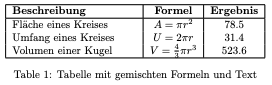
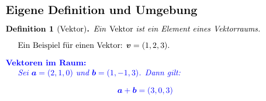

# LaTeX Workshop

Willkommen zum LaTeX-Workshop!  
In diesem Repository finden Sie **Anleitungen**, **Übungsaufgaben**, **Tipps & Tricks** sowie **Troubleshooting-Hinweise** rund um LaTeX für wissenschaftliches Arbeiten und technische Dokumentation.

---

## 🗓️ Workshop-Plan

| Einheit | Thema | Inhalt |
|----------|--------|--------|
| 1 | Grundlagen & Dokumentstruktur | Kurzer Überblick, minimale Dokumente, Abschnittsstruktur, Textformatierung |
| 2 | Mathe, Tabellen, Grafiken | Formeln, align-Umgebungen, Tabellen mit Formatierung, Abbildungen mit Beschriftung |
| 3 | Literatur & Best Practices | Bibliographien, nützliche Pakete, saubere Struktur, Wiederverwendung |
| 4 | [LaTeX Advanced](#-latex-advanced) | Befehle mit Logik, eigene Pakete und Klassen, Serienbrief, Beamer, große Projekte, Build & CI, Typografie |

Gesamtzeit: **13:50–16:15 Uhr (inkl. 15 Min Pause)**

Die Einheiten 1 bis 3 richten sich an Einsteiger:innen. Wer bereits Erfahrung mit LaTeX hat, kann direkt mit den [Bonusaufgaben](#-erweiterte-bonusaufgaben-für-fortgeschrittene) oder mit [LaTeX Advanced](#-latex-advanced) beginnen.

---

## 🚀 Einstieg

### 1️⃣ Setup
- **Empfohlen:** [Overleaf](https://www.overleaf.com)
  - oder eine weitere [Cloud-basierte Alternative](#-übersicht-cloudbasierte-latex-editoren)
- **Alternativ:**  
  - Installation von TeX Live (Linux, Windows), MacTeX (macOS) oder MiKTeX (Windows)  
  - Editor: VS Code + *LaTeX Workshop*-Extension
 

### 2️⃣ Minimales Dokument
```latex
\documentclass[a4paper,11pt]{article}
\begin{document}
Hallo Welt! Dies ist mein erstes LaTeX-Dokument.
\end{document}
```

---

## 📘 Einheit 1 — Grundstruktur & Formatierung

### 🔹 Ziele
- Dokumentaufbau verstehen (`\documentclass`, `\begin{document}`)
- Abschnitte, Listen und Textauszeichnungen einsetzen

### 🧩 Aufgabe 1
Erstellen Sie ein Dokument mit:
- Titel, Autor, Datum  
- Zwei Abschnitten: *Einleitung* & *Hauptteil*  
- Eine Liste (`itemize` oder `enumerate`)

### 💡 Tipp
Nutzen Sie `\maketitle` für automatische Titelerstellung.

---

## 🧮 Einheit 2 — Mathe, Tabellen & Abbildungen

### 🧩 Aufgabe 2: Formeln
Fügen Sie diese Formeln in Ihr Dokument ein:


### 🧩 Aufgabe 3: Tabelle
Erstellen Sie eine 3x3-Tabelle mit Überschriften:


### 🧩 Aufgabe 4: Abbildung
Binden Sie eine Grafik ein (z. B. `example-image`) mit Beschriftung und Referenz:
```latex
\begin{figure}[h]
  \centering
  \includegraphics[width=0.5\textwidth]{example-image}
  \caption{Beispielbild}
  \label{fig:beispiel}
\end{figure}
```

### 💡 Tipps
- Paket `graphicx` verwenden (`\usepackage{graphicx}`)
- Verweise mit `\ref{fig:beispiel}` einfügen

---

## 📚 Einheit 3 — Literatur, Pakete & Best Practices

### 🧩 Aufgabe 5: Literaturverzeichnis
Erstellen Sie eine Datei `literatur.bib`:
```bibtex
@book{lamport1994,
  author = {Leslie Lamport},
  title = {LaTeX: A Document Preparation System},
  year = {1994},
  publisher = {Addison-Wesley}
}
```
und verwenden Sie in der Präambel:
```latex
\usepackage[backend=biber,style=numeric]{biblatex}
\addbibresource{literatur.bib}
```

Im Text zitieren Sie mit `\cite{lamport1994}`. Das Literaturverzeichnis wird an der Stelle ausgegeben, an der `\printbibliography` steht (üblicherweise vor `\end{document}`).

Suchen Sie weitere 3 Quellen auf Google Scholar und fügen Sie diese ein (unter dem Treffer: *Zitieren* → *BibTeX*).

💡 **Hinweis:** Lokal sind die Durchläufe `pdflatex` → `biber` → `pdflatex` nötig. Overleaf und `latexmk` erledigen das automatisch.

---

## 🧰 Nützliche Pakete
| Paket | Beschreibung |
|--------|---------------|
| `graphicx` | Einbinden von Bildern |
| `amsmath` | Erweiterte Matheumgebungen |
| `hyperref` | Klickbare Links |
| `geometry` | Seitenränder anpassen |
| `babel` | Sprache einstellen |
| `minted` | Code-Highlighting (benötigt Python/Pygments; lokal je nach Version mit `-shell-escape` kompilieren) |
| `listings` | Code-Highlighting ohne externe Programme |

---

## ⚡ Bonus: Stil & Struktur
- Einheitliche Einrückungen
- Klarer Aufbau (`\section`, `\subsection`)
- Kommentare (`% Notiz`)
- Eigene Präambel-Datei `preamble.tex` für größere Projekte

---

## 🛠️ Troubleshooting

| Problem | Lösung |
|----------|---------|
| Umlaute fehlerhaft | Datei als UTF-8 speichern und `\usepackage[T1]{fontenc}` laden. `\usepackage[utf8]{inputenc}` ist seit LaTeX 2018 Standard und nur bei älteren Installationen nötig |
| Bilder fehlen | Prüfen, ob Datei im gleichen Ordner ist |
| Literatur wird nicht angezeigt | Biber statt BibTeX verwenden, `\printbibliography` nicht vergessen |
| Verweise zeigen `??` | Ein zweites Mal kompilieren |
| Mathe wird nicht zentriert | `\[ ... \]` statt `$ ... $` |

---

## 💎 Erweiterte Bonusaufgaben (für Fortgeschrittene)

Diese Aufgaben richten sich an Studierende mit bereits solider LaTeX-Erfahrung. Die Aufgaben fördern die Arbeit mit komplexeren Strukturen, Umgebungen und selbst definierten Befehlen.

---

### 🧮 **Bonusaufgabe 1 — Komplexe Formel mit Matrizen und Gleichungssystemen**
Erstellen Sie ein Gleichungssystem mit Matrizen und Variablen:
- Verwenden Sie die Umgebung `bmatrix` oder `pmatrix`
- Zeigen Sie eine Systemdarstellung z. B. für lineare Gleichungen


💡 **Tipp:** Nutzen Sie `amsmath` für fortgeschrittene Umgebungen (`cases`, `align`, `bmatrix`).

---

### 🧮 **Bonusaufgabe 2 — Mehrzeilige und referenzierbare Formeln**
Erstellen Sie eine längere Herleitung mit der `align`-Umgebung:
- Verwenden Sie mehrere Gleichungen mit `&` zur Ausrichtung
- Nummerieren und referenzieren Sie Zwischenschritte


💡 **Tipp:** Nutzen Sie `\label{}` und `\eqref{}` für Referenzen auf Gleichungen.

---

### 📊 **Bonusaufgabe 3 — Tabelle mit mehrzeiligen Überschriften und Zellen**
Erstellen Sie eine Tabelle mit:
- Spaltenüberschriften über mehrere Zeilen (`multirow`)
- Zusammengefassten Zellen (`multicolumn`)
- Linienstruktur mit `booktabs`


💡 **Tipp:** Verwenden Sie `\usepackage{multirow, booktabs}` und achten Sie auf gute Lesbarkeit durch `\toprule`, `\midrule`, `\bottomrule`.

---

### 📊 **Bonusaufgabe 4 — Tabellen mit Berechnungen oder Textausrichtung**
Erstellen Sie eine Tabelle mit gemischten Inhalten (Text und Formeln) und variabler Spaltenbreite.
- Nutzen Sie `p{}`-Spalten, um Text umbrechen zu lassen
- Setzen Sie Formeln in Zellen (`$...$` oder `\(...\)`)



💡 **Tipp:** Probieren Sie das Paket `array` für präzise Spaltenausrichtung.

---

### 🔧 **Bonusaufgabe 5 — Eigene Umgebung oder Befehlsdefinition**
Erstellen Sie:
1. Einen eigenen Befehl, z. B. `\newcommand{\vect}[1]{\boldsymbol{#1}}` zur Darstellung von Vektoren (`\boldsymbol` benötigt `amsmath`)  
2. Eine eigene Umgebung, z. B. `theorem`, `definition` oder `example` mit `\newenvironment`



💡 **Tipp:** Nutzen Sie `amsthm` für saubere Formatierung mathematischer Definitionen oder Sätze.

---

## ✨ Empfehlung
Speichern Sie Ihre Lösungen als separate `.tex`-Dateien (z. B. `bonus1.tex`, `bonus2.tex`, …) und fügen Sie diese im Hauptdokument mit `\input{bonus1.tex}` hinzu.  
So bleibt Ihr Projekt sauber strukturiert.

---

## 🌐 Übersicht: Cloudbasierte LaTeX-Editoren

Diese Tabelle bietet eine Übersicht über Online- bzw. Cloud-Plattformen für LaTeX (Stand: November 2026, Angaben laut Anbieter).

| Plattform | Kurzbeschreibung | Kostenmodell | Besonderheiten | URL |
|-----------|------------------|---------------|----------------|-----|
| **Overleaf** | Marktführender Cloud-LaTeX-Editor mit Echtzeit-Kollaboration und zahlreichen Vorlagen. | Kostenlos (1 Kollaborateur pro Projekt, Kompilier-Timeout 10 Sekunden) / Bezahlpläne für Einzelpersonen, Teams und Hochschulen | Weit verbreitet, stabil, ideal für Lehre und Gruppenprojekte. Git- und GitHub-Anbindung nur in Bezahlplänen | [https://www.overleaf.com](https://www.overleaf.com) |
| **Prism** (früher Crixet) | Cloud-LaTeX-Arbeitsumgebung von OpenAI mit integriertem KI-Assistenten und Echtzeit-Kollaboration. Crixet wurde im Jänner 2026 von OpenAI übernommen und in Prism überführt. | Kostenlos mit ChatGPT-Konto | Unbegrenzte Projekte und Mitwirkende; Inhalte liegen bei OpenAI | [https://openai.com/prism](https://openai.com/prism) |
| **Papeeria** | Online-LaTeX-Editor mit Mobile-Support und Git-Sync, LaTeX und Markdown mischbar. | Freemium | Echtzeit-Kollaboration, einfache Nutzerführung | [https://papeeria.com](https://papeeria.com) |
| **CoCalc** | Cloud-Rechner + LaTeX-Editor + Jupyter/Terminal auf Linux-Basis — geeignet für Lehre und Forschung. | Kostenlos (Basis) / Bezahlpläne | Vollständige Online-Umgebung mit Terminal-Zugriff | [https://cocalc.com](https://cocalc.com) |
| **Verbosus** | Browserbasierter LaTeX-Editor ohne Installation, mit Syntax-Highlighting und Vorschau. | Kostenlos / Freemium | Sehr einfacher Einstieg, geringerer Funktionsumfang | [https://www.verbosus.com](https://www.verbosus.com) |
| **Inscrive** | Online-LaTeX-Editor mit Fokus auf Kollaboration und Datenschutz, Hosting in der EU. | Kostenlos (10 aktive Projekte, unbegrenzte Mitwirkende) / Pro-Plan | Git-Sync, Versionsverlauf, Zotero- und Mendeley-Anbindung | [https://inscrive.io](https://inscrive.io) |

---

📘 *Empfohlen für Workshops und Lehre:* **Overleaf** (Standard)  
🧠 *Für erfahrene Anwender:innen:* **Prism** oder **CoCalc**  
💡 *Einfache Alternativen:* **Papeeria**, **Verbosus**

⚠️ *Overleaf:* Im kostenlosen Plan bricht die Kompilierung nach 10 Sekunden ab. Die Beispiele dieses Workshops liegen deutlich darunter.


---

## 📄 Lizenz
Dieses Material steht unter CC BY-SA 4.0.  
Erstellt von **Marc Kurz** (2025–2026).
