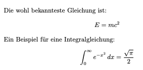
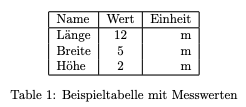
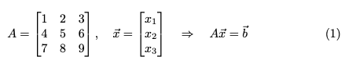
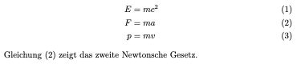
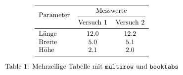

# LaTeX Workshop

Willkommen zum LaTeX-Workshop!  
In diesem Repository finden Sie **Anleitungen**, **Übungsaufgaben**, **Tipps & Tricks** sowie **Troubleshooting-Hinweise** rund um LaTeX für wissenschaftliches Arbeiten und technische Dokumentation.

---

## 🗓️ Workshop-Plan

| Einheit | Thema | Inhalt |
|----------|--------|--------|
| 1 | Grundlagen & Dokumentstruktur | Kurzer Überblick, minimale Dokumente, Abschnittsstruktur, Textformatierung |
| 2 | Mathe, Tabellen, Grafiken | Formeln, align-Umgebungen, Tabellen mit Formatierung, Abbildungen mit Beschriftung |
| 3 | Literatur & Best Practices | Bibliographien, nützliche Pakete, saubere Struktur, Wiederverwendung |
| 4 | [LaTeX Advanced](#-latex-advanced) | Befehle mit Logik, eigene Pakete und Klassen, Serienbrief, Beamer, große Projekte, Build & CI, Typografie |

Gesamtzeit: **13:50–16:15 Uhr (inkl. 15 Min Pause)**

Die Einheiten 1 bis 3 richten sich an Einsteiger:innen. Wer bereits Erfahrung mit LaTeX hat, kann direkt mit den [Bonusaufgaben](#-erweiterte-bonusaufgaben-für-fortgeschrittene) oder mit [LaTeX Advanced](#-latex-advanced) beginnen.

---

## 🚀 Einstieg

### 1️⃣ Setup
- **Empfohlen:** [Overleaf](https://www.overleaf.com)
  - oder eine weitere [Cloud-basierte Alternative](#-übersicht-cloudbasierte-latex-editoren)
- **Alternativ:**  
  - Installation von TeX Live (Linux, Windows), MacTeX (macOS) oder MiKTeX (Windows)  
  - Editor: VS Code + *LaTeX Workshop*-Extension
 

### 2️⃣ Minimales Dokument
```latex
\documentclass[a4paper,11pt]{article}
\begin{document}
Hallo Welt! Dies ist mein erstes LaTeX-Dokument.
\end{document}
```

---

## 📘 Einheit 1 — Grundstruktur & Formatierung

### 🔹 Ziele
- Dokumentaufbau verstehen (`\documentclass`, `\begin{document}`)
- Abschnitte, Listen und Textauszeichnungen einsetzen

### 🧩 Aufgabe 1
Erstellen Sie ein Dokument mit:
- Titel, Autor, Datum  
- Zwei Abschnitten: *Einleitung* & *Hauptteil*  
- Eine Liste (`itemize` oder `enumerate`)

### 💡 Tipp
Nutzen Sie `\maketitle` für automatische Titelerstellung.

---

## 🧮 Einheit 2 — Mathe, Tabellen & Abbildungen

### 🧩 Aufgabe 2: Formeln
Fügen Sie diese Formeln in Ihr Dokument ein:




### 🧩 Aufgabe 3: Tabelle
Erstellen Sie eine 3x3-Tabelle mit Überschriften:



### 🧩 Aufgabe 4: Abbildung
Binden Sie eine Grafik ein (z. B. `example-image`) mit Beschriftung und Referenz:
```latex
\begin{figure}[h]
  \centering
  \includegraphics[width=0.5\textwidth]{example-image}
  \caption{Beispielbild}
  \label{fig:beispiel}
\end{figure}
```

### 💡 Tipps
- Paket `graphicx` verwenden (`\usepackage{graphicx}`)
- Verweise mit `\ref{fig:beispiel}` einfügen

---

## 📚 Einheit 3 — Literatur, Pakete & Best Practices

### 🧩 Aufgabe 5: Literaturverzeichnis
Erstellen Sie eine Datei `literatur.bib`:
```bibtex
@book{lamport1994,
  author = {Leslie Lamport},
  title = {LaTeX: A Document Preparation System},
  year = {1994},
  publisher = {Addison-Wesley}
}
```
und verwenden Sie in der Präambel:
```latex
\usepackage[backend=biber,style=numeric]{biblatex}
\addbibresource{literatur.bib}
```

Im Text zitieren Sie mit `\cite{lamport1994}`. Das Literaturverzeichnis wird an der Stelle ausgegeben, an der `\printbibliography` steht (üblicherweise vor `\end{document}`).

Suchen Sie weitere 3 Quellen auf Google Scholar und fügen Sie diese ein (unter dem Treffer: *Zitieren* → *BibTeX*).

💡 **Hinweis:** Lokal sind die Durchläufe `pdflatex` → `biber` → `pdflatex` nötig. Overleaf und `latexmk` erledigen das automatisch.

---

## 🧰 Nützliche Pakete
| Paket | Beschreibung |
|--------|---------------|
| `graphicx` | Einbinden von Bildern |
| `amsmath` | Erweiterte Matheumgebungen |
| `hyperref` | Klickbare Links |
| `geometry` | Seitenränder anpassen |
| `babel` | Sprache einstellen |
| `minted` | Code-Highlighting (benötigt Python/Pygments; lokal je nach Version mit `-shell-escape` kompilieren) |
| `listings` | Code-Highlighting ohne externe Programme |

---

## ⚡ Bonus: Stil & Struktur
- Einheitliche Einrückungen
- Klarer Aufbau (`\section`, `\subsection`)
- Kommentare (`% Notiz`)
- Eigene Präambel-Datei `preamble.tex` für größere Projekte

---

## 🛠️ Troubleshooting

| Problem | Lösung |
|----------|---------|
| Umlaute fehlerhaft | Datei als UTF-8 speichern und `\usepackage[T1]{fontenc}` laden. `\usepackage[utf8]{inputenc}` ist seit LaTeX 2018 Standard und nur bei älteren Installationen nötig |
| Bilder fehlen | Prüfen, ob Datei im gleichen Ordner ist |
| Literatur wird nicht angezeigt | Biber statt BibTeX verwenden, `\printbibliography` nicht vergessen |
| Verweise zeigen `??` | Ein zweites Mal kompilieren |
| Mathe wird nicht zentriert | `\[ ... \]` statt `$ ... $` |

---

## 💎 Erweiterte Bonusaufgaben (für Fortgeschrittene)

Diese Aufgaben richten sich an Studierende mit bereits solider LaTeX-Erfahrung. Die Aufgaben fördern die Arbeit mit komplexeren Strukturen, Umgebungen und selbst definierten Befehlen.

---

### 🧮 **Bonusaufgabe 1 — Komplexe Formel mit Matrizen und Gleichungssystemen**
Erstellen Sie ein Gleichungssystem mit Matrizen und Variablen:
- Verwenden Sie die Umgebung `bmatrix` oder `pmatrix`
- Zeigen Sie eine Systemdarstellung z. B. für lineare Gleichungen



💡 **Tipp:** Nutzen Sie `amsmath` für fortgeschrittene Umgebungen (`cases`, `align`, `bmatrix`).

---

### 🧮 **Bonusaufgabe 2 — Mehrzeilige und referenzierbare Formeln**
Erstellen Sie eine längere Herleitung mit der `align`-Umgebung:
- Verwenden Sie mehrere Gleichungen mit `&` zur Ausrichtung
- Nummerieren und referenzieren Sie Zwischenschritte



💡 **Tipp:** Nutzen Sie `\label{}` und `\eqref{}` für Referenzen auf Gleichungen.

---

### 📊 **Bonusaufgabe 3 — Tabelle mit mehrzeiligen Überschriften und Zellen**
Erstellen Sie eine Tabelle mit:
- Spaltenüberschriften über mehrere Zeilen (`multirow`)
- Zusammengefassten Zellen (`multicolumn`)
- Linienstruktur mit `booktabs`



💡 **Tipp:** Verwenden Sie `\usepackage{multirow, booktabs}` und achten Sie auf gute Lesbarkeit durch `\toprule`, `\midrule`, `\bottomrule`.

---

### 📊 **Bonusaufgabe 4 — Tabellen mit Berechnungen oder Textausrichtung**
Erstellen Sie eine Tabelle mit gemischten Inhalten (Text und Formeln) und variabler Spaltenbreite.
- Nutzen Sie `p{}`-Spalten, um Text umbrechen zu lassen
- Setzen Sie Formeln in Zellen (`$...$` oder `\(...\)`)


💡 **Tipp:** Probieren Sie das Paket `array` für präzise Spaltenausrichtung.

---

### 🔧 **Bonusaufgabe 5 — Eigene Umgebung oder Befehlsdefinition**
Erstellen Sie:
1. Einen eigenen Befehl, z. B. `\newcommand{\vect}[1]{\boldsymbol{#1}}` zur Darstellung von Vektoren (`\boldsymbol` benötigt `amsmath`)  
2. Eine eigene Umgebung, z. B. `theorem`, `definition` oder `example` mit `\newenvironment`


💡 **Tipp:** Nutzen Sie `amsthm` für saubere Formatierung mathematischer Definitionen oder Sätze.

---

## ✨ Empfehlung
Speichern Sie Ihre Lösungen als separate `.tex`-Dateien (z. B. `bonus1.tex`, `bonus2.tex`, …) und fügen Sie diese im Hauptdokument mit `\input{bonus1.tex}` hinzu.  
So bleibt Ihr Projekt sauber strukturiert.

---

## 🎓 LaTeX Advanced

Dieser Teil richtet sich an Studierende, die mit den Grundlagen bereits vertraut sind. Sie bauen Schritt für Schritt eigene Werkzeuge: zuerst Befehle mit Logik, daraus ein eigenes Paket, dann eine eigene Dokumentklasse für Briefpapier im FH-Stil und einen Serienbrief. Danach folgen Präsentationen mit Beamer, die Struktur großer Projekte, automatisiertes Bauen und typografischer Feinschliff.

### 🗺️ Überblick

| Aufgabe | Thema | Ordner | Baut auf |
|---------|-------|--------|----------|
| A1 | Befehle mit Logik | `advanced/a1-befehle` | Bonusaufgabe 5 |
| A2 | Eigenes Paket (`.sty`) | `advanced/a2-paket` | A1 |
| A3 | Eigene Klasse (`.cls`): Briefpapier | `advanced/a3-brief` | A2 |
| A4 | Serienbrief aus CSV-Daten | `advanced/a3-brief` | A3 |
| A5 | Präsentationen mit Beamer und eigenem Theme | `advanced/a5-beamer` | A2 |
| A6 | Große Projekte strukturieren | `advanced/a6-projekt` | – |
| A7 | Build-Automatisierung und CI | `advanced/a6-projekt` | A6 |
| A8 | Typografie-Feinschliff | `advanced/a8-typografie` | – |

A1 bis A4 bilden ein durchgehendes Projekt und sollten in dieser Reihenfolge bearbeitet werden. A5 bis A8 sind voneinander unabhängig (Ausnahme: A7 verwendet das Projekt aus A6).

### 🧭 So arbeiten Sie mit den Dateien

- Im `main`-Branch liegen **Startdateien**. Jede Startdatei lässt sich sofort kompilieren. Die offenen Stellen sind mit `TODO` markiert, vorbereitete Testzeilen sind auskommentiert.
- Im `musterlsg`-Branch liegen unter denselben Pfaden die **fertigen, kommentierten Lösungen**.
- Zu den anspruchsvolleren Schritten gibt es aufklappbare **Hilfestellungen** (💡) direkt unter den Schritten. Versuchen Sie es zuerst ohne.
- **Lokal:** Wechseln Sie in den jeweiligen Ordner und kompilieren Sie dort, z. B. `cd advanced/a1-befehle` und `pdflatex uebungsblatt.tex`.
- **Overleaf:** Legen Sie pro Aufgabe ein Projekt an und laden Sie **alle Dateien des Ordners** hoch (auch `.sty`, `.cls`, `.csv` und das Logo). Wählen Sie über *Menu → Main document* die jeweilige `.tex`-Datei.
- Pakete (`.sty`) und Klassen (`.cls`) müssen im selben Ordner liegen wie das Dokument, das sie lädt.

---

### 🔧 A1 — Befehle mit Logik

**Ziel:** Befehle schreiben, die optionale Argumente und Sternvarianten kennen, mitzählen und Schleifen ausführen.

**Datei:** `advanced/a1-befehle/uebungsblatt.tex`

#### Erklärung

`\newcommand` kennt nur ein einziges optionales Argument. Flexibler ist `\NewDocumentCommand`. Der Befehl ist seit LaTeX 2020-10 ohne Zusatzpaket verfügbar (bei älteren Installationen: `\usepackage{xparse}`).

```latex
\NewDocumentCommand{\name}{Argumentbeschreibung}{Definition}
```

Die Argumentbeschreibung besteht aus einem Buchstaben pro Argument:

| Kürzel | Bedeutung | Abfrage in der Definition |
|--------|-----------|---------------------------|
| `m` | Pflichtargument in `{ }` | – |
| `o` | optionales Argument in `[ ]`, ohne Standardwert | `\IfNoValueTF{#1}{fehlt}{vorhanden}` |
| `O{wert}` | optionales Argument mit Standardwert | – |
| `s` | optionaler Stern, z. B. `\section*` | `\IfBooleanTF{#1}{mit Stern}{ohne Stern}` |

Beispiel: `{s O{0} m}` beschreibt einen Befehl mit Stern (`#1`), optionalem Argument (`#2`, Standard 0) und Pflichtargument (`#3`).

**Zähler** speichern ganze Zahlen:

```latex
\newcounter{aufgabe}          % anlegen (Startwert 0)
\stepcounter{aufgabe}         % um 1 erhöhen
\addtocounter{punkte}{3}      % 3 addieren
\theaufgabe                   % Wert ausgeben
```

**Bedingungen** auf Zahlen: `\ifnum#1>0 ... \else ... \fi`

**Schleifen** mit dem Paket `pgffor`: `\foreach \i in {1,...,5}{ ... }`

#### Schritte

1. **Sternvariante:** Definieren Sie `\fh`. Ohne Stern liefert der Befehl „FH Oberösterreich“, mit Stern „University of Applied Sciences Upper Austria“. Entfernen Sie danach das `%` vor der Testzeile zu Schritt 1.
2. **Zähler:** Legen Sie die Zähler `aufgabe` und `punkte` an.
3. **`\aufgabe[Punkte]{Titel}`:** Der Befehl erhöht die Aufgabennummer, addiert die Punkte zur Summe und gibt eine Überschrift der Form „Aufgabe 1: Titel“ aus. Rechts steht „(3 Punkte)“. Bei 0 Punkten entfällt die Angabe, bei 1 Punkt steht „Punkt“ statt „Punkte“.
4. **Schleife:** `\antwortzeilen{n}` zeichnet `n` Schreiblinien über die ganze Textbreite (`\rule{\linewidth}{0.4pt}`).
5. Geben Sie am Ende des Dokuments die Summe mit `\thepunkte` aus.

<details>
<summary>💡 Hilfestellung zu Schritt 3 und 4</summary>

Gerüst für `\aufgabe`. Es fehlt nur noch die Punkteangabe:

```latex
\NewDocumentCommand{\aufgabe}{O{0} m}{%
  \stepcounter{aufgabe}%
  \addtocounter{punkte}{#1}%
  \subsection*{Aufgabe \theaufgabe: #2%
    % TODO: Punkteangabe ergänzen
  }%
}
```

Bausteine für die Punkteangabe:
- `\ifnum#1>0 ... \fi` gibt den Inhalt nur aus, wenn Punkte vergeben sind.
- `\hfill` schiebt alles Folgende an den rechten Rand.
- `{\normalfont\small(#1~Punkte)}` setzt die Angabe klein und nicht fett. `~` ist ein Leerzeichen ohne Zeilenumbruch.
- `\ifnum#1=1 Punkt\else Punkte\fi` wählt Einzahl oder Mehrzahl.

Gerüst für `\antwortzeilen`:

```latex
\NewDocumentCommand{\antwortzeilen}{m}{%
  \par
  \foreach \i in {1,...,#1}{%
    % TODO: eine Linie über die ganze Breite, danach \par
  }%
}
```

`\rule{0pt}{8mm}` vor der Linie erzeugt eine unsichtbare Stütze und damit 8 mm Abstand zwischen den Linien.

</details>

#### Kontrolle

Das PDF zeigt drei nummerierte Aufgaben mit Punkteangaben, darunter Schreiblinien und am Ende „Erreichbare Punkte: 4“.

💡 **Stolperstein:** Ein Zeilenende im Quelltext zählt als Leerzeichen. In Definitionen beendet man Zeilen deshalb oft mit `%`, damit keine ungewollten Leerzeichen im PDF landen.

---

### 📦 A2 — Eigenes Paket (`.sty`)

**Ziel:** Die Befehle aus A1 in ein wiederverwendbares Paket auslagern, das Optionen kennt.

**Dateien:** `advanced/a2-paket/mcstyle.sty`, `advanced/a2-paket/paket-test.tex`

#### Erklärung

Ein Paket ist eine `.sty`-Datei mit Definitionen. `\usepackage{mcstyle}` lädt die Datei `mcstyle.sty`. So bleibt die Präambel kurz, und derselbe Stil lässt sich in vielen Dokumenten verwenden.

Aufbau eines Pakets:

```latex
\NeedsTeXFormat{LaTeX2e}[2020/10/01]                 % Mindestversion von LaTeX
\ProvidesPackage{mcstyle}[2026/11/23 v1.0 Beschreibung]  % Name = Dateiname

\newif\ifmc@entwurf                                  % Schalter anlegen (Standard: false)
\DeclareOption{entwurf}{\mc@entwurftrue}             % Option setzt den Schalter
\ProcessOptions\relax                                % Optionen auswerten

\RequirePackage{xcolor}                              % statt \usepackage

% ... eigene Definitionen ...

\endinput
```

Wichtige Punkte:

- **`\RequirePackage` statt `\usepackage`:** In Paketen und Klassen lädt man andere Pakete mit `\RequirePackage`.
- **Das Zeichen `@`:** In `.sty`- und `.cls`-Dateien darf `@` in Befehlsnamen vorkommen. Man kennzeichnet damit interne Befehle (z. B. `\mc@entwurftrue`), die im Dokument nicht direkt verwendet werden sollen. Ein Präfix wie `mc@` vermeidet Namenskonflikte mit anderen Paketen.
- **Schalter mit `\newif`:** `\newif\ifmc@entwurf` erzeugt drei Befehle: `\mc@entwurftrue`, `\mc@entwurffalse` und die Abfrage `\ifmc@entwurf ... \else ... \fi`.
- **Optionen:** `\DeclareOption{name}{Code}` legt fest, was bei `\usepackage[name]{mcstyle}` passiert. `\DeclareOption*{...}` behandelt alle unbekannten Optionen.

**Werte über zwei Durchläufe hinweg:** Die Punktesumme steht erst am Dokumentende fest. Soll sie schon am Anfang erscheinen, schreibt man sie am Ende in die `.aux`-Datei. Beim nächsten Durchlauf liest LaTeX diese Datei bei `\begin{document}` ein. Nach demselben Prinzip funktionieren `\label` und `\ref`. Deshalb sind zwei Durchläufe nötig.

#### Schritte

1. **Optionen:** Legen Sie die Schalter `\ifmc@entwurf` und `\ifmc@sw` an. Deklarieren Sie die Optionen `entwurf` und `sw`. Unbekannte Optionen sollen eine Warnung ausgeben (`\PackageWarning{mcstyle}{...}`).
2. **Pakete:** Laden Sie `xcolor` und `pgffor`.
3. **Farben:** Definieren Sie `fhrot` mit `\definecolor{fhrot}{RGB}{192,0,0}`. Im Schwarz-Weiß-Modus (`sw`) soll `fhrot` schwarz sein.
4. **Befehle verschieben:** Übernehmen Sie `\fh`, die Zähler, `\aufgabe` und `\antwortzeilen` aus A1. Färben Sie „Aufgabe 1:“ mit `\textcolor{fhrot}{...}`. Entfernen Sie in `paket-test.tex` die Kommentarzeichen vor den passenden Zeilen.
5. **Gesamtpunkte:** Schreiben Sie die Summe mit `\AtEndDocument` und `\immediate\write\@auxout{...}` in die `.aux`-Datei. Definieren Sie `\gesamtpunkte`, das den gespeicherten Wert ausgibt (beim ersten Durchlauf `??`).
6. **Umgebung:** Definieren Sie mit `\NewDocumentEnvironment{hinweis}{O{Hinweis}}{Anfang}{Ende}` einen Hinweiskasten mit rotem, optionalem Titel. Zusatz für Schnelle: ein roter Balken links neben dem Text.
7. **Entwurfsmodus:** `\anmerkung{Text}` zeigt den Text nur im Entwurfsmodus rot an. Ohne die Option erzeugt der Befehl keine Ausgabe.

<details>
<summary>💡 Hilfestellung zu Schritt 5 (Gesamtpunkte)</summary>

Dieser Schritt ist der anspruchsvollste der Aufgabe. Der Code lautet:

```latex
\AtEndDocument{%
  \immediate\write\@auxout{%
    \gdef\string\mc@gesamt{\the\value{punkte}}}%
}
\newcommand{\gesamtpunkte}{%
  \@ifundefined{mc@gesamt}{??}{\mc@gesamt}%
}
```

So lesen Sie den Code:
- `\AtEndDocument{...}` führt den Inhalt bei `\end{document}` aus.
- `\immediate\write\@auxout{...}` schreibt eine Zeile in die `.aux`-Datei.
- `\string\mc@gesamt` schreibt den Befehlsnamen als Text. `\the\value{punkte}` wird sofort durch die aktuelle Zahl ersetzt. In der `.aux`-Datei steht danach `\gdef \mc@gesamt{4}`.
- Beim nächsten Durchlauf führt LaTeX diese Zeile bei `\begin{document}` aus. Damit ist `\mc@gesamt` von Anfang an bekannt.
- `\@ifundefined{mc@gesamt}{??}{\mc@gesamt}` gibt beim ersten Durchlauf `??` aus und danach den Wert.

Öffnen Sie nach dem Kompilieren die Datei `paket-test.aux` und suchen Sie die Zeile.

</details>

<details>
<summary>💡 Hilfestellung zu Schritt 6 und 7</summary>

Einfache Fassung der Umgebung mit rotem Titel:

```latex
\NewDocumentEnvironment{hinweis}{O{Hinweis}}{%
  \par\medskip\noindent
  \textbf{\textcolor{fhrot}{#1:}}\par
}{%
  \par\medskip
}
```

Der erste Block in geschweiften Klammern läuft bei `\begin{hinweis}`, der zweite bei `\end{hinweis}`. `#1` ist der optionale Titel. Die Fassung mit rotem Balken links finden Sie in der Musterlösung.

`\anmerkung` wird je nach Schalter unterschiedlich definiert:

```latex
\ifmc@entwurf
  \newcommand{\anmerkung}[1]{\textcolor{fhrot}{[\textbf{Anm.:} #1]}}
\else
  \newcommand{\anmerkung}[1]{}
\fi
```

</details>

#### Kontrolle

- `\usepackage{mcstyle}`: rote Aufgabentitel, keine Anmerkungen.
- `\usepackage[entwurf]{mcstyle}`: Vermerk „ENTWURF“ am Anfang, Anmerkungen sichtbar.
- `\usepackage[sw]{mcstyle}`: alles in Schwarz.
- Nach dem zweiten Durchlauf steht bei „Insgesamt sind … Punkte erreichbar“ die richtige Zahl.

💡 **Stolperstein:** Im Dokument selbst ist `@` kein Buchstabe. Befehle wie `\mc@gesamt` funktionieren dort nur zwischen `\makeatletter` und `\makeatother`. In der `.sty`-Datei ist das nicht nötig.

💡 **Ausblick:** Aktuelle LaTeX-Versionen (ab 2022-06) bieten mit `\DeclareKeys` und `\ProcessKeyOptions` auch Optionen der Form `farbe=rot`.

---

### ✉️ A3 — Eigene Klasse (`.cls`): Briefpapier im FH-Stil

**Ziel:** Eine eigene Dokumentklasse `fhbrief` schreiben, die Briefpapier mit Logo, Kopf- und Fußzeile erzeugt. Das Dokument enthält danach nur noch den Inhalt.

**Dateien:** `advanced/a3-brief/fhbrief.cls`, `advanced/a3-brief/brief.tex`, `advanced/a3-brief/fh-logo.jpg`

#### Erklärung

| | Paket (`.sty`) | Klasse (`.cls`) |
|---|---|---|
| Geladen mit | `\usepackage{...}` | `\documentclass{...}` |
| Anzahl pro Dokument | beliebig viele | genau eine |
| Aufgabe | einzelne Funktionen ergänzen | Grundgerüst des Dokuments festlegen |
| Kopfzeile | `\ProvidesPackage` | `\ProvidesClass` |

Eine Klasse schreibt man fast nie von Grund auf. Man lädt eine bestehende Klasse mit `\LoadClass` und passt sie an:

```latex
\ProvidesClass{fhbrief}[2026/11/23 v1.0 Briefpapier]
\DeclareOption*{\PassOptionsToClass{\CurrentOption}{article}}  % z. B. 11pt weiterreichen
\ProcessOptions\relax
\LoadClass[a4paper]{article}                                   % Basisklasse
```

Die Klasse verwendet ein wiederkehrendes Muster, um Daten vom Dokument entgegenzunehmen:

```latex
\newcommand{\fhb@betreff}{}                                 % interner Speicher
\newcommand{\betreff}[1]{\renewcommand{\fhb@betreff}{#1}}   % Befehl für das Dokument
```

Kopf- und Fußzeilen setzt das Paket `fancyhdr`: `\fancyhead[L]{...}` belegt die Kopfzeile links, `\fancyfoot[L]{...}` die Fußzeile links. Die Seitenränder legt `geometry` fest.

#### Schritte

Die Abschnitte 1 bis 4 der Klasse sind vorgegeben. Ergänzen Sie die Abschnitte 5 bis 10:

1. **Farben (5):** `fhrot` (RGB 192,0,0) und `fhgrau` (RGB 100,100,100).
2. **Seitenlayout (6):** Ränder mit `\geometry{left=25mm, right=20mm, top=42mm, bottom=32mm, headheight=16mm, headsep=12mm, footskip=14mm}`. Kein Absatzeinzug (`\parindent`), dafür Abstand zwischen Absätzen (`\parskip`).
3. **Briefdaten (8):** Befehle `\absender{Name}{Straße}{PLZ Ort}`, `\empfaenger{...}`, `\betreff{...}`, `\datum{...}` und `\gruss{...}` nach dem Muster oben. Standardwerte: Datum `\today`, Gruß „Mit freundlichen Grüßen“.
4. **Kopfzeile (9):** Links das Logo (`\includegraphics[height=13mm]{fh-logo.jpg}`), daneben eine rote Linie bis zum rechten Rand. Schalten Sie die Standardlinie von `fancyhdr` mit `\renewcommand{\headrulewidth}{0pt}` aus.
5. **Fußzeile (9):** Rote Linie, darunter in kleiner grauer Schrift der Absender und rechts die Seitenzahl.
6. **Umgebung `brief` (10):** `\begin{brief}{Anrede}` beginnt eine neue Seite, setzt die Seitenzahl auf 1 und gibt Adressfeld, Ort und Datum, Betreff und Anrede aus. `\end{brief}` gibt Grußformel und Namen aus.
7. **Optionen (2 und 7):** `nologo` ersetzt das Logo durch Text. `english` lädt `babel` mit `english` und stellt „Seite“ auf „Page“ sowie die Grußformel um. Legen Sie dazu Schalter an (wie in A2) und ersetzen Sie die festen Texte in Kopfzeile, Fußzeile und Grußformel durch Makros, die je nach Schalter unterschiedlich definiert sind.
8. Entfernen Sie in `brief.tex` die Kommentarzeichen und tragen Sie mit `\absender` Ihre eigenen Daten ein.

<details>
<summary>💡 Hilfestellung zu Schritt 3 (Briefdaten)</summary>

```latex
% Absender mit Standardwerten
\newcommand{\fhb@absname}{FH-Prof. Dr. Marc Kurz}
\newcommand{\fhb@absstrasse}{Softwarepark 11}
\newcommand{\fhb@absort}{4232 Hagenberg}
\newcommand{\absender}[3]{%
  \renewcommand{\fhb@absname}{#1}%
  \renewcommand{\fhb@absstrasse}{#2}%
  \renewcommand{\fhb@absort}{#3}%
}

\newcommand{\fhb@empfaenger}{}
\newcommand{\empfaenger}[1]{\renewcommand{\fhb@empfaenger}{#1}}
```

`\betreff`, `\datum` und `\gruss` folgen demselben Muster. Bei `\datum` ist der Standardwert `\today`, bei `\gruss` die Grußformel.

</details>

<details>
<summary>💡 Hilfestellung zu Schritt 4 und 5 (Kopf- und Fußzeile)</summary>

```latex
\pagestyle{fancy}
\fancyhf{}                              % alle Felder leeren
\renewcommand{\headrulewidth}{0pt}      % Standardlinien von fancyhdr aus
\renewcommand{\footrulewidth}{0pt}

% Kopfzeile: Logo, daneben eine rote Linie bis zum rechten Rand
\fancyhead[L]{%
  \makebox[\textwidth][l]{%
    \includegraphics[height=13mm]{fh-logo.jpg}\hspace{6mm}%
    {\color{fhrot}\leaders\hrule height 7.1mm depth -6.5mm\hfill\kern0pt}%
  }%
}

% Fußzeile: rote Linie, darunter Absender und Seitenzahl
\fancyfoot[L]{%
  \parbox[t]{\textwidth}{%
    {\color{fhrot}\rule{\textwidth}{0.6pt}}\\[1mm]
    \footnotesize\color{fhgrau}%
    \fhb@absname\ \textbullet\ \fhb@absstrasse\ \textbullet\ \fhb@absort
    \hfill Seite\ \thepage
  }%
}
```

- `\makebox[\textwidth][l]{...}` ist eine Box in voller Textbreite mit linksbündigem Inhalt.
- `\parbox[t]{\textwidth}{...}` ist ein Absatzkasten, in dem `\\` einen Zeilenumbruch erzeugt.
- In Schritt 7 ersetzen Sie das Logo und das Wort „Seite“ durch Makros, die von den Optionen abhängen.

</details>

<details>
<summary>💡 Hilfestellung zu Schritt 6 (Umgebung brief)</summary>

```latex
\newenvironment{brief}[1]{%
  \clearpage
  \setcounter{page}{1}%
  % Adressfeld mit fester Höhe
  \begin{minipage}[t][40mm][t]{85mm}
    {\tiny\color{fhgrau}\underline{\fhb@absname, \fhb@absstrasse, \fhb@absort}}\par
    \vspace{3mm}
    \fhb@empfaenger
  \end{minipage}
  \par
  \hfill \fhb@absort, \fhb@datum \par
  \vspace{6mm}
  \ifx\fhb@betreff\@empty\else
    \textbf{\fhb@betreff}\par
    \vspace{4mm}
  \fi
  #1\par
}{%
  \par
  \vspace{6mm}
  \fhb@gruss\par
  \vspace{12mm}%
  \fhb@absname\par
  \clearpage
}
```

- Der erste Block läuft bei `\begin{brief}{Anrede}`, `#1` ist die Anrede. Der zweite Block läuft bei `\end{brief}`.
- `\begin{minipage}[t][40mm][t]{85mm}` ist ein Kasten mit 85 mm Breite und fester Höhe von 40 mm. So beginnt der Brieftext immer an derselben Stelle.

</details>

#### Kontrolle

Das PDF zeigt einen einseitigen Brief: oben das FH-Logo mit roter Linie, Adressfeld, Datum rechts, fetter Betreff, Text, Grußformel und unten die Fußzeile mit Absender und Seitenzahl. Mit `\documentclass[11pt,nologo]{fhbrief}` verschwindet das Logo.

💡 **Tipps:**
- `\IfFileExists{fh-logo.jpg}{vorhanden}{fehlt}` verhindert einen Abbruch, wenn die Logodatei fehlt.
- Eine Linie, die den restlichen Platz füllt: `\leaders\hrule height 7.1mm depth -6.5mm\hfill\kern0pt`. `height` und `depth` bestimmen, in welcher Höhe die Linie verläuft.
- Leeren Betreff erkennen: `\ifx\fhb@betreff\@empty ... \else ... \fi`
- Für Briefe im Alltag gibt es fertige Klassen, z. B. `scrlttr2` aus KOMA-Script. In dieser Aufgabe geht es um das Prinzip.

---

### 📨 A4 — Serienbrief aus CSV-Daten

**Ziel:** Aus einer CSV-Datei mit Adressen automatisch einen Brief pro Datensatz erzeugen.

**Dateien:** `advanced/a3-brief/empfaenger.csv` (vorgegeben), `advanced/a3-brief/serienbrief.tex` (neu anlegen)

#### Erklärung

Das Paket `csvsimple` liest eine CSV-Datei zeilenweise und führt für jede Zeile denselben Code aus:

```latex
\csvreader[head to column names]{empfaenger.csv}{}{%
  % dieser Code läuft einmal pro Datenzeile
  \name{} wohnt in \ort.\par
}
```

Mit `head to column names` wird aus jeder Spaltenüberschrift ein Befehl: Die Spalte `name` liefert `\name`, die Spalte `ort` liefert `\ort`. Die Datei `empfaenger.csv` enthält die Spalten `anrede`, `name`, `strasse`, `ort` und `thema`.

#### Schritte

1. Legen Sie `serienbrief.tex` im Ordner `advanced/a3-brief` an. Verwenden Sie `\documentclass[11pt]{fhbrief}` und laden Sie `csvsimple`.
2. Setzen Sie den Betreff einmal in der Präambel.
3. Schreiben Sie im Dokument einen `\csvreader`-Aufruf. Setzen Sie darin pro Zeile den Empfänger (`\empfaenger{\name\\\strasse\\\ort}`) und einen Brief mit `\begin{brief}{\anrede,}`.
4. Verwenden Sie im Brieftext die Spalte `thema`.
5. Ergänzen Sie in der CSV-Datei eine vierte Zeile und kompilieren Sie erneut.

#### Kontrolle

Das PDF hat so viele Seiten wie die CSV-Datei Datenzeilen hat (zu Beginn 3). Jede Seite trägt eine andere Adresse und Anrede und die Seitenzahl 1.

💡 **Stolpersteine:**
- Spaltenüberschriften dürfen nur Buchstaben enthalten und nicht wie bestehende Befehle heißen (also nicht `empfaenger` oder `betreff`).
- Das Trennzeichen ist das Komma. Felder, die selbst ein Komma enthalten, gehören in geschweifte Klammern: `{Testweg 3, Stiege 2}`. Anführungszeichen funktionieren hier nicht.
- Zeilen mit falscher Spaltenanzahl überspringt `csvsimple` ohne Fehlermeldung. Fehlt ein Brief, prüfen Sie zuerst die Kommas in der betreffenden Zeile.

---

### 🖥️ A5 — Präsentationen mit Beamer und eigenem Theme

**Ziel:** Folien mit schrittweisem Aufbau erstellen und ein eigenes Farb- und Layout-Theme schreiben.

**Dateien:** `advanced/a5-beamer/folien.tex`, `advanced/a5-beamer/beamerthemeFH.sty` (neu anlegen), `advanced/a5-beamer/fh-logo.jpg`

#### Erklärung

`beamer` ist eine Dokumentklasse für Präsentationen. Jede Folie ist eine `frame`-Umgebung:

```latex
\documentclass[aspectratio=169]{beamer}
\begin{document}
\begin{frame}{Titel der Folie}
  Inhalt
\end{frame}
\end{document}
```

**Overlays** bauen eine Folie in mehreren Schritten auf. Aus einer Folie werden dabei mehrere PDF-Seiten:

| Befehl | Wirkung |
|--------|---------|
| `\pause` | alles danach erscheint erst im nächsten Schritt |
| `\item<2->` | Punkt ist ab Schritt 2 sichtbar |
| `\item<3>` | Punkt ist nur in Schritt 3 sichtbar |
| `\only<1>{...}` | Inhalt nur in Schritt 1, belegt sonst keinen Platz |
| `\alert{...}` | Hervorhebung in der Akzentfarbe |

**Themes:** `\usetheme{FH}` lädt die Datei `beamerthemeFH.sty`. Ein Theme ist also ein Paket mit festem Namensschema. Darin passt man Farben, Schriften und Vorlagen an:

```latex
\setbeamercolor{structure}{fg=fhrot}              % Akzentfarbe
\setbeamerfont{frametitle}{series=\bfseries}      % Schrift des Folientitels
\setbeamertemplate{navigation symbols}{}          % Navigationssymbole ausblenden
\setbeamertemplate{footline}{ ... }               % eigene Fußzeile
```

#### Schritte

1. **Overlays:** Ergänzen Sie auf der Folie „Schrittweiser Aufbau“ ein `\pause` zwischen den Punkten.
2. Verwenden Sie auf der Folie „Overlays gezielt steuern“ die Angaben `<1->`, `<2->` und `<3>` sowie `\only`.
3. **Spalten:** Teilen Sie die Folie „Blöcke und Spalten“ mit `columns` und `column` in zwei Spalten. Links steht ein `block`, rechts eine Formel.
4. **Theme anlegen:** Erstellen Sie `beamerthemeFH.sty`. Beginnen Sie mit `\ProvidesPackage{beamerthemeFH}` und `\mode<presentation>`. Definieren Sie `fhrot` und setzen Sie die Akzentfarbe.
5. Setzen Sie den Folientitel schwarz und fett, blenden Sie die Navigationssymbole aus und färben Sie Blocktitel rot mit weißer Schrift.
6. **Fußzeile:** Links „SEITE | Nummer“ (`\insertframenumber`), dann eine rote Linie, rechts das Logo.
7. Aktivieren Sie das Theme in `folien.tex` mit `\usetheme{FH}`.

<details>
<summary>💡 Hilfestellung zu Schritt 4 bis 6 (Theme)</summary>

```latex
\ProvidesPackage{beamerthemeFH}[2026/11/23 v1.0 Beamer-Theme im FH-OOe-Stil]
\mode<presentation>

\definecolor{fhrot}{RGB}{192,0,0}
\definecolor{fhgrau}{RGB}{100,100,100}

\setbeamercolor{structure}{fg=fhrot}
\setbeamercolor{frametitle}{fg=black}
\setbeamercolor{block title}{fg=white,bg=fhrot}
\setbeamercolor{block body}{bg=black!5}
\setbeamerfont{frametitle}{series=\bfseries,size=\Large}
\setbeamerfont{footline}{size=\tiny}
\setbeamertemplate{navigation symbols}{}

\setbeamertemplate{footline}{%
  \leavevmode
  \hspace{5mm}%
  \raisebox{2mm}{\usebeamerfont{footline}\textcolor{fhgrau}{SEITE | \insertframenumber}}%
  \hspace{3mm}%
  {\color{fhrot}\leaders\hrule height 3.3mm depth -2.9mm\hfill\kern0pt}%
  \hspace{3mm}%
  \IfFileExists{fh-logo.jpg}{\includegraphics[height=6mm]{fh-logo.jpg}}{}%
  \hspace{5mm}%
  \vspace{2mm}%
}

\mode<all>
\endinput
```

Die Fußzeile besteht aus vier Teilen nebeneinander: Text mit Foliennummer, Linie, Logo, Randabstand. `\raisebox{2mm}{...}` hebt den Text an, damit er auf Höhe der Linie steht. Die Musterlösung enthält zusätzlich eine eigene Titelfolie.

</details>

#### Kontrolle

Die Präsentation hat 4 Folien, durch die Overlays aber 8 PDF-Seiten. Akzentfarbe ist das FH-Rot, in der Fußzeile stehen Seitennummer, rote Linie und Logo.

💡 **Stolperstein:** Folien mit `\verb` oder `verbatim` brauchen die Option `[fragile]`: `\begin{frame}[fragile]{Titel}`.

---

### 🗂️ A6 — Große Projekte strukturieren

**Ziel:** Ein Dokument in mehrere Dateien aufteilen, Verweise automatisieren, ein Abkürzungsverzeichnis führen und offene Punkte markieren. Diese Techniken sind die Grundlage für Bachelor- und Masterarbeiten.

**Datei:** `advanced/a6-projekt/main.tex` (alles in einer Datei)

#### Erklärung

**Dateien einbinden:**

| Befehl | Wirkung | Einsatz |
|--------|---------|---------|
| `\input{datei}` | fügt den Inhalt genau an dieser Stelle ein | Präambel-Teile, Tabellen, Abkürzungen |
| `\include{datei}` | wie `\input`, beginnt aber eine neue Seite und führt eine eigene `.aux`-Datei | Kapitel |
| `\includeonly{a,b}` | übersetzt nur die genannten `\include`-Dateien | schnelleres Kompilieren |

Mit `\includeonly` bleiben Seitenzahlen und Verweise der ausgelassenen Kapitel erhalten, weil LaTeX deren `.aux`-Dateien weiter liest.

**Verweise mit `cleveref`:** `\cref{tab:befehle}` erzeugt „Tabelle 2.1“ statt nur „2.1“. Das passende Wort ergänzt das Paket selbst. Am Satzanfang verwendet man `\Cref`. Mehrere Ziele: `\cref{ch:a,ch:b}`.

**Abkürzungen mit `glossaries`:**

```latex
\usepackage[acronym,nomain]{glossaries}
\makenoidxglossaries
\newacronym{ci}{CI}{Continuous Integration}
% im Text:
\gls{ci}          % erstes Mal: Continuous Integration (CI), danach: CI
% am Ende:
\printnoidxglossary[type=\acronymtype,title=Abkürzungsverzeichnis]
```

Die Variante mit `\makenoidxglossaries` braucht kein Zusatzprogramm und funktioniert in Overleaf und lokal gleich. Für sehr lange Verzeichnisse gibt es die schnellere Variante mit `\makeglossaries` und dem Programm `makeglossaries`.

**Randnotizen mit `todonotes`:** `\todo{Text}` setzt eine Notiz in den Rand, `\todo[inline]{Text}` in den Text, `\listoftodos` listet alle auf. Mit der Paketoption `disable` verschwinden alle Notizen aus dem PDF.

**Reihenfolge in der Präambel:** `hyperref` → `glossaries` → `cleveref`. `cleveref` wird als letztes Paket geladen.

#### Schritte

1. **Aufteilen:** Legen Sie den Ordner `kapitel/` an. Verschieben Sie jedes Kapitel in eine eigene Datei (`einleitung.tex`, `grundlagen.tex`, `fazit.tex`) und binden Sie die Dateien mit `\include{kapitel/einleitung}` usw. ein.
2. Testen Sie `\includeonly{kapitel/grundlagen}` und beobachten Sie, dass Inhaltsverzeichnis und Verweise vollständig bleiben. Kommentieren Sie die Zeile danach wieder aus.
3. **Verweise:** Laden Sie `\usepackage[ngerman]{cleveref}` und ersetzen Sie alle Stellen der Form `Kapitel~\ref{...}` durch `\cref{...}`.
4. **Abkürzungen:** Legen Sie `abkuerzungen.tex` mit den Abkürzungen CI, CD und PDF an und binden Sie die Datei in der Präambel mit `\input` ein. Ersetzen Sie die Abkürzungen im Text durch `\gls{...}` und geben Sie das Verzeichnis am Ende aus.
5. **Randnotizen:** Laden Sie `todonotes`, ersetzen Sie den Kommentar `% TODO` durch `\todo{...}` und ergänzen Sie `\listoftodos` nach dem Inhaltsverzeichnis.

#### Kontrolle

Das PDF enthält Inhaltsverzeichnis, Todo-Liste, drei Kapitel und ein Abkürzungsverzeichnis mit Seitenzahlen. Im Text steht „Continuous Integration (CI)“ beim ersten Vorkommen und danach „CI“. Verweise lauten „Kapitel 2“, „Tabelle 2.1“ und „Abschnitt 2.1“.

💡 **Stolperstein:** Nach Änderungen an Verweisen oder Abkürzungen sind zwei bis drei Durchläufe nötig. `latexmk` (siehe A7) erledigt das automatisch.

---

### ⚙️ A7 — Build-Automatisierung und CI

**Ziel:** Das Projekt aus A6 mit einem Befehl bauen und bei jedem Push automatisch von GitHub bauen lassen.

**Voraussetzung:** Teil 1 und 2 benötigen eine lokale LaTeX-Installation. Teil 3 benötigt einen GitHub-Account und funktioniert auch ohne lokale Installation. In Overleaf läuft `latexmk` bereits im Hintergrund.

#### Erklärung

`latexmk` ist in TeX Live, MacTeX und MiKTeX enthalten (unter Windows ist zusätzlich Perl nötig). Das Programm erkennt selbst, wie oft `pdflatex` laufen muss und ob `biber` oder andere Hilfsprogramme nötig sind.

| Befehl | Wirkung |
|--------|---------|
| `latexmk -pdf main.tex` | baut das PDF mit allen nötigen Durchläufen |
| `latexmk -pdf -pvc main.tex` | baut bei jeder Änderung automatisch neu (Abbruch mit Strg+C) |
| `latexmk -c` | löscht Hilfsdateien, das PDF bleibt |
| `latexmk -C` | löscht Hilfsdateien und PDF |

Eine Datei `.latexmkrc` im Projektordner speichert die Einstellungen. Danach genügt der Aufruf `latexmk`.

**Continuous Integration:** Ein GitHub-Actions-Workflow ist eine YAML-Datei im Ordner `.github/workflows/`. GitHub führt die Schritte darin bei jedem Push auf einem eigenen Server aus. So ist sichergestellt, dass das Dokument auch auf einem frischen System kompiliert.

#### Schritte

**Teil 1: latexmk**

1. Wechseln Sie in `advanced/a6-projekt` und bauen Sie das Projekt mit `latexmk -pdf main.tex`.
2. Starten Sie `latexmk -pdf -pvc main.tex`, ändern Sie einen Satz in einem Kapitel und speichern Sie.
3. Räumen Sie mit `latexmk -c` auf.

**Teil 2: .latexmkrc**

4. Legen Sie in `advanced/a6-projekt` die Datei `.latexmkrc` an:

```perl
$pdf_mode = 1;                       # PDF mit pdflatex erzeugen
$pdflatex = 'pdflatex -interaction=nonstopmode -file-line-error -halt-on-error %O %S';
@default_files = ('main.tex');       # "latexmk" ohne Argument baut main.tex
```

5. Bauen Sie nun mit `latexmk` ohne weitere Angaben.

**Teil 3: GitHub Actions**

6. Erstellen Sie einen Fork dieses Repositories in Ihrem GitHub-Account und aktivieren Sie dort im Reiter *Actions* die Workflows.
7. Legen Sie die Datei `.github/workflows/build.yml` an:

```yaml
name: LaTeX bauen
on: [push, workflow_dispatch]

jobs:
  build:
    runs-on: ubuntu-latest
    steps:
      - name: Repository auschecken
        uses: actions/checkout@v6
      - name: PDF bauen
        uses: xu-cheng/latex-action@v4
        with:
          working_directory: advanced/a6-projekt
          root_file: main.tex
      - name: PDF als Artefakt hochladen
        uses: actions/upload-artifact@v6
        with:
          name: projektbericht
          path: advanced/a6-projekt/main.pdf
```

8. Committen und pushen Sie die Datei. Öffnen Sie den Reiter *Actions*, verfolgen Sie den Lauf und laden Sie das PDF unter *Artifacts* herunter.
9. Bauen Sie absichtlich einen Fehler ein (z. B. `\begin{itemize}` ohne `\end{itemize}`), pushen Sie und sehen Sie sich den fehlgeschlagenen Lauf an.

#### Kontrolle

Der Workflow-Lauf ist grün und das Artefakt `projektbericht` enthält `main.pdf`. Nach dem eingebauten Fehler ist der Lauf rot und das Log nennt Datei und Zeile.

💡 **Tipps:**
- Ergänzen Sie die `.gitignore` um Hilfsdateien wie `*.toc`, `*.out`, `*.tdo`, `*.acn`, `*.acr`, `*.alg` und `*.glo`.
- Schreiben Sie im Quelltext einen Satz pro Zeile. Dann zeigt `git diff` genau die geänderten Sätze.
- Das Programm `latexdiff alt.tex neu.tex > diff.tex` erzeugt ein Dokument, in dem Änderungen zwischen zwei Fassungen farbig markiert sind.

---

### ✒️ A8 — Typografie-Feinschliff

**Ziel:** Mit drei Paketen das Schriftbild sichtbar verbessern.

**Datei:** `advanced/a8-typografie/typografie.tex`

#### Erklärung

| Paket | Aufgabe | Wichtigste Befehle |
|-------|---------|--------------------|
| `microtype` | feinerer Randausgleich, weniger Trennungen | nur laden |
| `csquotes` | sprachrichtige Anführungszeichen | `\enquote{Text}` |
| `siunitx` | Zahlen und Einheiten einheitlich setzen | `\num`, `\qty`, `\unit`, Spaltentyp `S` |

Beispiele zu `siunitx` (mit der Option `locale=DE` erscheint ein Dezimalkomma):

```latex
\num{1234567.89}                      % 1 234 567,89
\qty{12.5}{\kilo\metre\per\hour}      % 12,5 km/h mit korrektem Abstand
\unit{\micro\second}                  % nur die Einheit
\qtyrange{10}{20}{\celsius}           % Bereich
```

Der Spaltentyp `S` richtet Zahlen in Tabellen am Dezimaltrennzeichen aus: `\begin{tabular}{l S[table-format=3.2]}`. Text in einer `S`-Spalte (z. B. die Überschrift) gehört in geschweifte Klammern.

#### Schritte

1. Laden Sie `csquotes` mit der Option `autostyle` und ersetzen Sie die getippten Anführungszeichen durch `\enquote{...}`.
2. Laden Sie `siunitx` mit `locale=DE` und setzen Sie alle Zahlen und Einheiten der Liste mit `\num`, `\qty` und `\qtyrange`.
3. Stellen Sie die beiden Zahlenspalten der Tabelle auf den Typ `S` um und setzen Sie die Überschriften in `{ }`.
4. Laden Sie `microtype` und vergleichen Sie den Absatz „Randausgleich“ vorher und nachher.

#### Kontrolle

Anführungszeichen erscheinen als „…“, Zahlen mit Dezimalkomma und Tausenderabstand, die Tabellenwerte stehen am Komma ausgerichtet untereinander.

💡 **Hinweis:** `\qty` und `\unit` gibt es seit `siunitx` Version 3 (2021). Ältere Installationen kennen nur `\SI` und `\si`.

---

## 🌐 Übersicht: Cloudbasierte LaTeX-Editoren

Diese Tabelle bietet eine Übersicht über Online- bzw. Cloud-Plattformen für LaTeX (Stand: November 2026, Angaben laut Anbieter).

| Plattform | Kurzbeschreibung | Kostenmodell | Besonderheiten | URL |
|-----------|------------------|---------------|----------------|-----|
| **Overleaf** | Marktführender Cloud-LaTeX-Editor mit Echtzeit-Kollaboration und zahlreichen Vorlagen. | Kostenlos (1 Kollaborateur pro Projekt, Kompilier-Timeout 10 Sekunden) / Bezahlpläne für Einzelpersonen, Teams und Hochschulen | Weit verbreitet, stabil, ideal für Lehre und Gruppenprojekte. Git- und GitHub-Anbindung nur in Bezahlplänen | [https://www.overleaf.com](https://www.overleaf.com) |
| **Prism** (früher Crixet) | Cloud-LaTeX-Arbeitsumgebung von OpenAI mit integriertem KI-Assistenten und Echtzeit-Kollaboration. Crixet wurde im Jänner 2026 von OpenAI übernommen und in Prism überführt. | Kostenlos mit ChatGPT-Konto | Unbegrenzte Projekte und Mitwirkende; Inhalte liegen bei OpenAI | [https://openai.com/prism](https://openai.com/prism) |
| **Papeeria** | Online-LaTeX-Editor mit Mobile-Support und Git-Sync, LaTeX und Markdown mischbar. | Freemium | Echtzeit-Kollaboration, einfache Nutzerführung | [https://papeeria.com](https://papeeria.com) |
| **CoCalc** | Cloud-Rechner + LaTeX-Editor + Jupyter/Terminal auf Linux-Basis — geeignet für Lehre und Forschung. | Kostenlos (Basis) / Bezahlpläne | Vollständige Online-Umgebung mit Terminal-Zugriff | [https://cocalc.com](https://cocalc.com) |
| **Verbosus** | Browserbasierter LaTeX-Editor ohne Installation, mit Syntax-Highlighting und Vorschau. | Kostenlos / Freemium | Sehr einfacher Einstieg, geringerer Funktionsumfang | [https://www.verbosus.com](https://www.verbosus.com) |
| **Inscrive** | Online-LaTeX-Editor mit Fokus auf Kollaboration und Datenschutz, Hosting in der EU. | Kostenlos (10 aktive Projekte, unbegrenzte Mitwirkende) / Pro-Plan | Git-Sync, Versionsverlauf, Zotero- und Mendeley-Anbindung | [https://inscrive.io](https://inscrive.io) |

---

📘 *Empfohlen für Workshops und Lehre:* **Overleaf** (Standard)  
🧠 *Für erfahrene Anwender:innen:* **Prism** oder **CoCalc**  
💡 *Einfache Alternativen:* **Papeeria**, **Verbosus**

⚠️ *Overleaf:* Im kostenlosen Plan bricht die Kompilierung nach 10 Sekunden ab. Die Beispiele dieses Workshops sind bewusst klein gehalten.


---

## 📄 Lizenz
Dieses Material steht unter CC BY-SA 4.0.  
Erstellt von **Marc Kurz** (2025–2026).
